

<!--_paginate: false -->
# Numerical study of a experimental KUBC homogenization device

## Présentation intermédiaire

Robin Valmalette

*28.03.2023*

---

# Sommaire
1. Reminder de la machine
2. Présentation du modèle
   1. Hypothèses de modélisation
   2. Géométrie des pièces
   3. Intégrations et conditions aux limites
   4. Exploitation des résultats
3. Présentation des modèles KUBC et PBC théoriques
4. Présentation des résultats
   1. Echantillon monolithique
   2. Echantillon nid d'abeille

---

<!--header: Présentation du modèle -->

# Reminder: la machine
- KUBC discret (10 supports par côté)
- Eprouvette de 288x288 mm (KIBC théorique : 308x308 mm)
  
<lab>

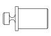

Schema de la picece de liason Cylindre-Pantographes

</lab>

<lab>

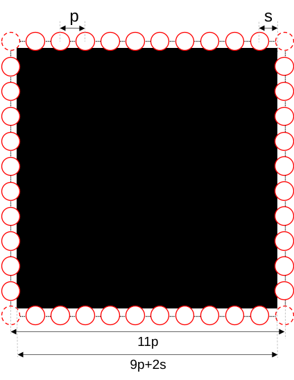
Schema de la machinea avec les supports cylindriques en rouge. (p=28 mm, s=18mm)

</lab>

---

## Hypothèses générales de modélisation

- Modèle 3D
- Elasticité linéaire 
- HPP (géométrie non linéaire dans le cas de simulation non-linéaire *ie* avec frottement et jeux)
- Défauts en amont des cylindres négligés.

---

## Géométrie des pièces

Géométries utilisées :

- Monolithique
- Nid d'abeille
  
Et dans les cartons (partiellement opérationel) :

- Carre
- Hexachiral
- Kagome

</lab>

<lab>

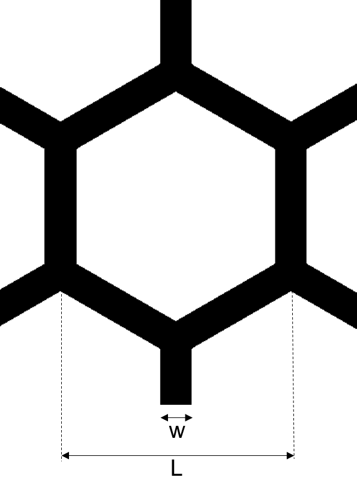

Schema du nid d'abeille hexagonal avec $L$ et $w$ les deux paramètres géométriques.

---

## Exemple d'éprouvette

### Algorithme de génération :

1. Génération de la géométrie à l'infini
2. Translation et rotation du motif
3. Découpe de l'empreinte "machine"
4. Ajout des supports (si besoin)
5. Découpe des coins (optionnel, env 18mm de profondeur)

  
<lab> 

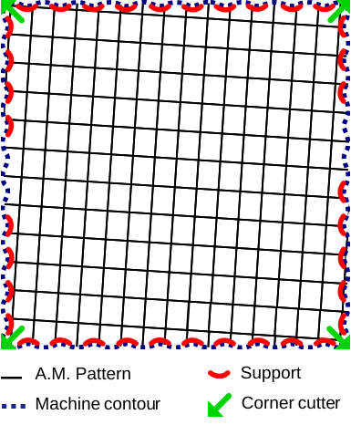
Schema du processus de génération des éprouvettes

</lab>

---

## Intéraction et conditions aux limites

2 Choix de modélisation:

- Cylindres parfaits (connecteurs rigides)
- Cylindres non parfait (jeux, raideur et frottement introduit dans les connecteurs)

Remarque : 2 connecteurs sont représentés sur la figure par soucis de compréhension mais 1 est suffisant.

<lab>

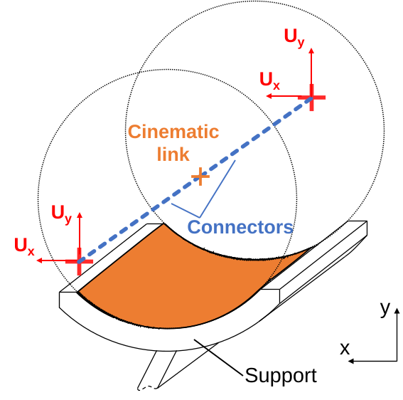

Hyp cylindre imparfait (calcul non linéaire). Ajout de la raideur, du jeu et frottement dans les connecteurs. Les BC sont schématisées en rouge.

---

## Comportement de la liason complète

- Radieur radiale (issu calcul poutre + FE)
- Jeu radial (distribution gaussienne tronquée) 
  - $\mu_\delta=30~\mu m$
  - $\delta_{min}=4~\mu m \;\; \delta_{max}=43~\mu m$
- Frottement angulaire (type palier)
  - $f = 0.1$
  - $C_0 = 250~N.mm$

<lab>

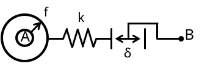

Dessin et schema réhologique d'une liason cylindre - pantographe

---

## Maillage

| Model                       | Type elmt      | Taille [mm] | nb d'élts | nb nds | nb DdL | CPU Time [min] |
| --------------------------- | -------------- | ----------- | --------- | ------ | ------ | -------------- |
| PBC 2D                      | Tri Quad       | 0.1         |           |        |        | 1              |
| KUBC 2D                     | Tri Quad       | 0.4         | 300k      | 600k   | 1.2M   | 1              |
| KUBC 3D (Nida porosity 27%) | Tri prism Quad | 0.8         | 500k      | 1.5M   | 4.5M   | 4 - 150        |

L'utilsation d'elt de 0.4 pour le calcul 3 a montré un écart d'eviron 1% terme de contraintes et deformations. 5 elts quadratique dans l'épaisseur sera le critère.

<lab>

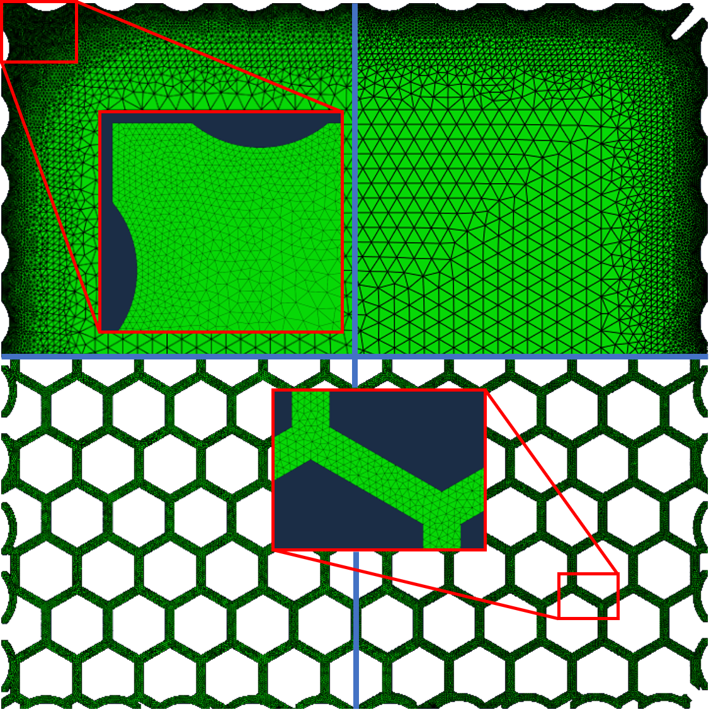

Exemple de maillage sur un nida 3D.

---

## Historique de chargement

Step 1 : traction horizontale ($x$). $\epsilon_{xx}=2~\%$
Step 2 : traction verticale ($y$). $\epsilon_{yy}=2~\%$
Step 3 : cisaillement ($xy$). $\gamma_{xy}=2~\%$

Traction pour éviter le risque de flambage.

---

## Exploitation des résultats

<lab>

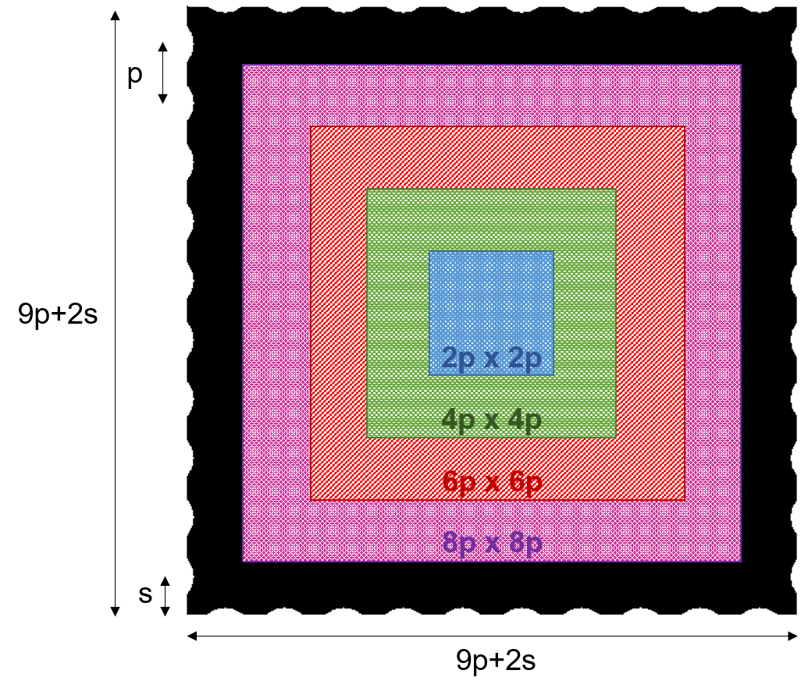

Schéma des différentes zones pour l'extraction du champ de contrainte et du calcul du champ de déformation sur une éprouvettes avec les coins découpés (cutter `ADV_SHEAR`).

</lab>

---

## Extraction et calcul:

- Le champ de contrainte
  - "Field" : moyenne de la contrainte pondérée par le volume $\times$ (1-porosité)
  - "Panto" : Calcul via les efforts aux BCs (relation théorique)
- Le champ de déformation
  - Récupération des déplacements aux noeuds + régression des moindres carrés (déformation + MCR). Expérimentalement équivalent à la DIC (Hyp).

- Matrices de rigidités
  - Matrice $K_{field}$ obtenue avec la contrainte "Field" et la déformation "DIC"
  - Matrice $K_{panto}$ obtenue avec la contrainte "Panto" et la déformation "DIC"

---

## Simulations complémentaires

Avec *HOMTOOLS* (S. Lejeune - LMA)

- PBC contrainte plane : simulation avec une cellule élémentaire
- KUBC théorique contrainte plane : échantillon carré de la taille de la machine

Remarque : Pour le monolithique, nous comparerons à la matrice théorique elas. isotrope en contrainte plane. 

<lab>

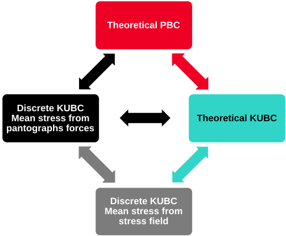

Schéma des différentes erreurs sucepetible d'être comparées (non exhaustif)

</lab>

---

## Critères de comparaison 

Besoin d'avoir une unique valeur (premier indicateur d'erreur).
Définition erreur cumulée de $K^a$ par rapport à $K^b$ :

$$ r_c(K^a,K^b)= \frac{\lVert K^a-K^b\rVert_F}{\max\limits_{ij}K^b_{ij}} \quad \mbox{with}\quad \lVert A\rVert_F=\sqrt{\sum_{i,j}A^2_{ij}} $$

Remarque : $\lVert \cdot\rVert_F$ est la norme de Frobenius.

---

# Plan de présentation - Campagne de  simu

1. MONO
   1. Comparaison erreur (lin, non lin, avec ou sans libre rotation) en 3D
   2. Qualité des champs en non lin. avec et sans découpe des coins
   3. Etude de l'influence de $\nu$ et de l'épaisseur en 3D
2. HONEY
   1. Etude du placement en 2D machine parfaite
   2. Qualité des champs : placement an fonction du point précédent
   3. Comparaison erreur (comme MONO)
   4. Etude de l'influence du placement avec le Honey 28 et 25.2
   5. Effet de la taille du motif (effet d'echelle) $28(i+10)/10\quad i\in[-5,5]$
3. autre geo

---

<!--header: Présentation des résultats -->
# Etude sur un échantillon monolithique

Epaisseur : 30 mm
Module d'Young : 9 MPa
Coefficient de Poisson : 0.3

Step 1 : traction horizontale $\epsilon_{xx}=2\,\%$
Step 2 : traction verticale $\epsilon_{yy}=2\,\%$
Step 3 : cisaillement $\gamma_{xy}=2\,\%$

 
---

## Champs de contrainte sur un monolithique traction x

Dans tous les cas de figure, la qualité des champs est **très** similaire.

<lab>

</lab>

| Area              | $2p\times 2p$ | $4p\times 4p$ | $6p\times 6p$ | $8p\times 8p$ | whole specimen |
| ----------------- | ------------- | ------------- | ------------- | ------------- | -------------- |
| Mean stress [MPa] | 0.21059       | 0.21047       | 0.21029       | 0.21020       | 0.21108        |

<ce>

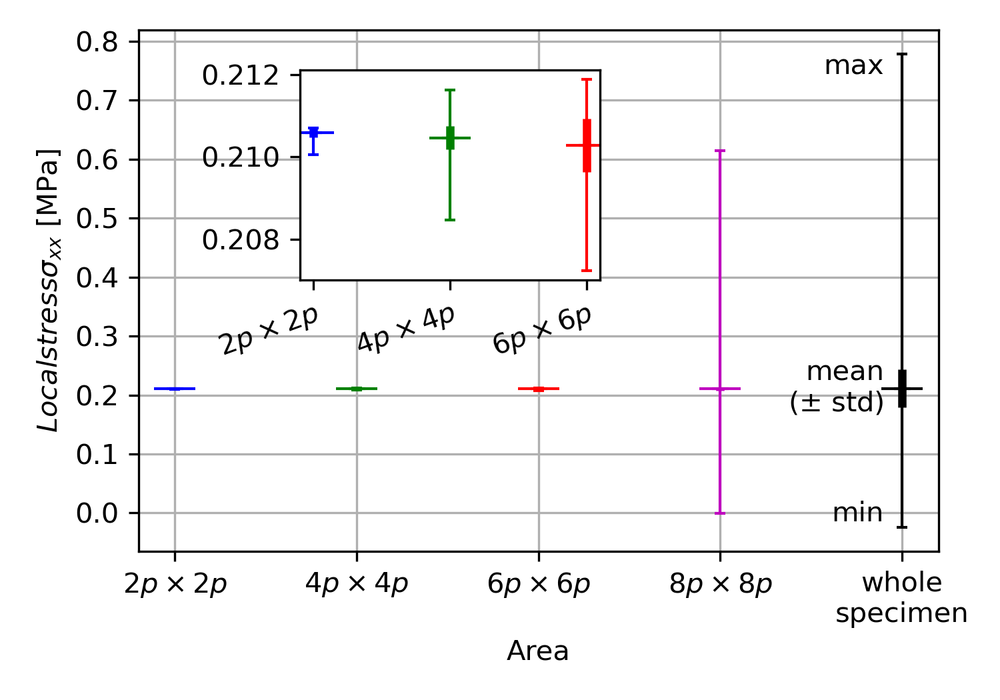
Dispersion des valeurs de contrainte $\sigma_{xx}$ dans les différentes zones. La dernière zone n'est pas montré ici car la plage est trop grande. (Ref essai : MONO_1). The mean values are in a $\pm$ 0.2% window. 

---

#### Champs de déformation
 
<ce>

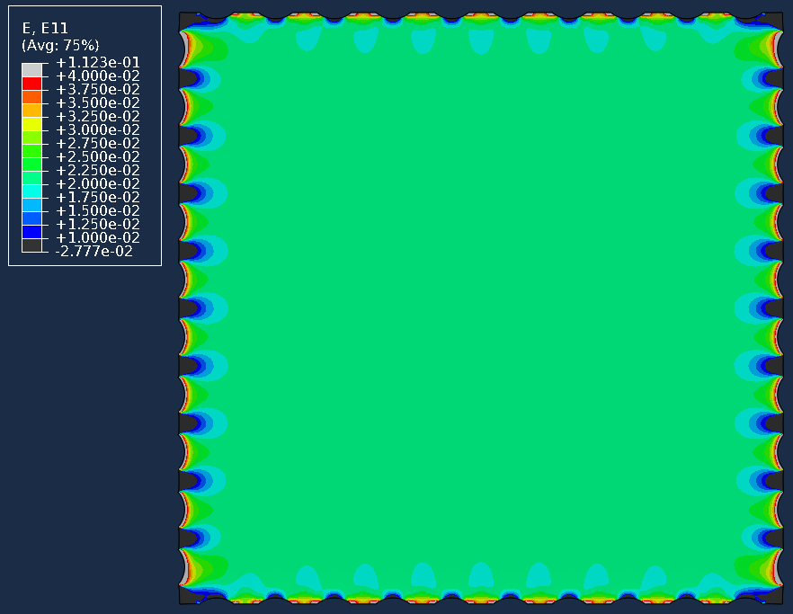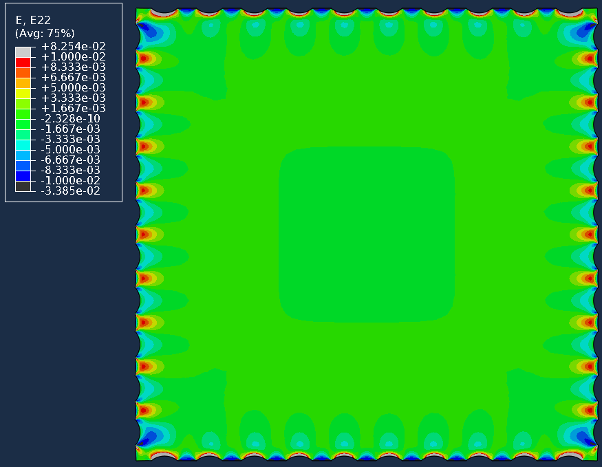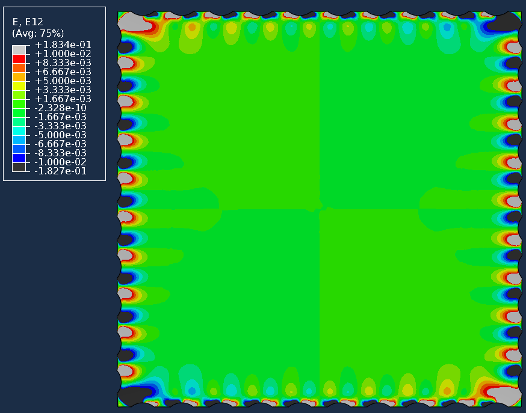

MONO_1 (Machine parfaite, echantillon sans entaille). De droite à gauche : E11, E22, E12 en chargement de traction horizontale.

CCL : C'est utltra homogène

---

## Champs de déformation sur un monolithique

| Step | $\epsilon_{11}$ [%] | $\epsilon_{22}$ [%] | $\epsilon_{12}$ [%] |
| ---- | ------------------- | ------------------- | ------------------- |
| 1    | 2.117 (**+5.6%**)   | 0.003               | 0.000               |
| 2    | 0.003               | 2.117 (**+5.6%**)   | 0.000               |
| 3    | 0.000               | 0.000               | 0.967 (**-3.3%**)   |

Explication : Hyp ~cylindres incompressibles ($9p+2s\times9p+2s$ specimen)
$$\Rightarrow\epsilon_{eff}=\epsilon_{BC}\frac{11p}{9p+2s}$$
AN: $\epsilon_{BC}=2\%\Rightarrow \epsilon_{eff}=2.14\%$

<ce>

---

# Résumé des premiers essais monolithiques

| test_id    | corner cutter |  free rot.   |           Defects            | Err. Plane Stress - Field [%] | Err. Field - Panto [%] | Err. Plane Stress - Panto [%] |
| ---------- | :-----------: | :----------: | :--------------------------: | :---------------------------: | :--------------------: | :---------------------------: |
| MONO_1     |   $\times$    | $\checkmark$ |             None             |             0.75              |          4.44          |             4.71              |
| MONO_2_NL  |   $\times$    | $\checkmark$ |          Stiffness           |             1.04              |          3.86          |             3.35              |
| MONO_2b_NL |   $\times$    | $\checkmark$ |     Stiffness+clearance      |             1.25              |          3.49          |             2.46              |
| MONO_2t_NL |   $\times$    | $\checkmark$ | Stiffness+clearance+friction |             1.23              |          3.61          |             3.40              |
| MONO_3     | $\checkmark$  | $\checkmark$ |             None             |             1.06              |          1.58          |             2.26              |
| MONO_4_NL  | $\checkmark$  | $\checkmark$ | Stiffness+clearance+friction |             1.00              |          1.76          |             2.26              |
| MONO_5     | $\checkmark$  |   $\times$   |             None             |             1.04              |          1.92          |             2.95              |
| MONO_6     |   $\times$    |   $\times$   |             None             |             0.99              |          5.42          |             6.41              |

Ccl : Les erreurs sont de l'ordre de 2-4%. L'erreur entre le champ et les pantographes peut être amélioré avec les découpes. Important de laisser la libre rotation des cylindres. La qualité des champs est dans tous les cas très similaire.

---

## Efforts dans les cylindres : impacte des defauts

<lab>

Froces dans les cylindres côté superieur. Cas monolitique sans découpe non lin. stiffness+clearance.

</lab>

<lab>

Froces dans les cylindres côté superieur. Cas monolitique sans découpe non lin. stiffness+clearance+FRICTION.

</lab>

Remarque : Bloquer la rotation (frottement ou blocage complet) augmente la réésultante moyenne en cisaillement.

---

## Efforts dans les cylindres : impact de la découpe

<lab>

Froces dans les cylindres côté superieur. Cas monolitique SANS découpe sans defaut.

</lab>

<lab>

Froces dans les cylindres côté superieur. Cas monolitique AVEC découpe sans defaut.

</lab>

Remarque : La découpe augmente les efforts dans les coins en cisaillement (alors que c'est en particulier sur ce chargement qu'on pensait le résuire ...)

---

## Effet de l'épaisseur et de $\nu$ sur les résultats

Condition d'expérience :

- Avec découpe des coins
- Cylindres parfaits avec la rotation libre
- E=9 MPa

|   test_id   | $\nu$ | Thickness | Err.[%] |
| :--------- | :---: | :-------: | :---------------------------: |
| MONO_t_nu_1 | 0.15  |    30     |             **2.00**              |
| MONO_t_nu_2 | 0.15  |    10     |             **1.91**              |
| MONO_t_nu_3 | 0.45  |    30     |             **2.93**              |
| MONO_t_nu_4 | 0.45  |    10     |             **1.57**              |

Err: Erreur Plane stress - Pantho.

Ccl : L'effet est faible (1.5% d'écart entre min max)-> pourquoi pas essayer de faire du 2D

---

## Monolithic : 3D $\rightarrow$ 2D + Effet maillage

Hyp : Libre rotation + Aucun defaut

| test_id        | Dimension | Découpe | Maillage | Err. Plane stress - Panto |
| -------------- | --------- | ------- | -------: | ------------------------: |
| MONO_1         | 3D        | SANS    |    Moyen |                  **4.71** |
| MONO_2D_1_gros | 2D        | SANS    |    Moyen |                  **3.79** |
| MONO_2D_1_fin  | 2D        | SANS    |      Fin |                  **3.92** |
| MONO_3         | 3D        | AVEC    |    Moyen |                  **2.26** |
| MONO_2D_3_gros | 2D        | AVEC    |    Moyen |                  **1.42** |
| MONO_2D_3_fin  | 2D        | AVEC    |      Fin |                  **1.59** |

Moyen : 0.8 mm sur les bord, 7 mm au centre
Fin : 0.4 mm sur les bord, 7 mm au centre

Passage en 2D-Plane stress -> diminution de l'erreur d'env. 1%. Effet du maillage <0.2%

---

### Sources d'erreurs sur un monolithique

<lab>

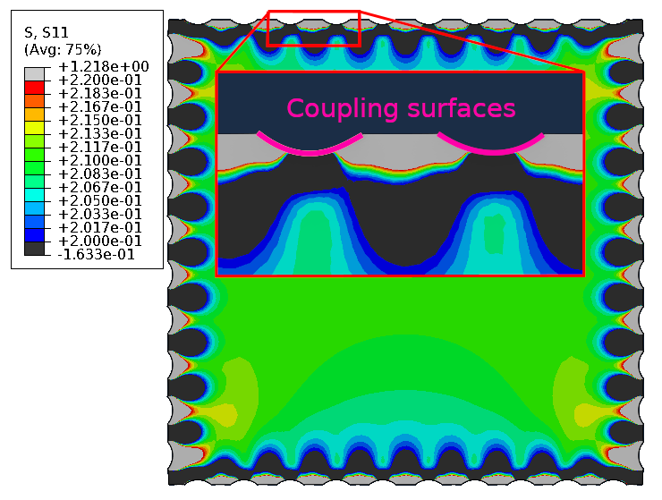

Champ local $\sigma_{11}$ chargement traction horizontale (ref MONO_1, aucun defaut)

</lab>

$\sigma_{11_{Field}}=0.210~\mbox{MPa}$
$\sigma_{11_{Panto}}=0.215~\mbox{MPa}$

L'erreur vient des portions d'éprouvettes qui sont entre les cylindres. Localement la contrainte est beaucoup plus importante (et c'est pourquoi la contrainte est sur-estimée avec les pantos).
Si on veut encore augmenter la precision du monolithique, une solution serait de faire une entaille entre chaque cylindre afin d'assouplpir la région.

---

### Effet des entailles dans les coins

<lab>

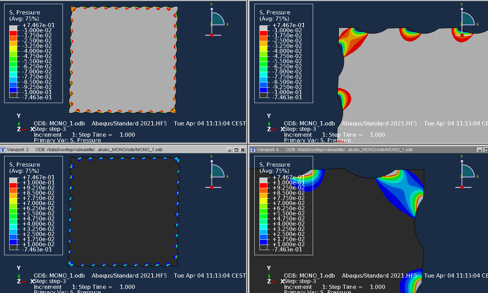

Pressure ($p=-\frac{1}{3}tr(\sigma)$). MONO_1 SANS entaille

$\sigma_{12_{Field}}=0.0664~\mbox{MPa}$
$\sigma_{12_{Panto}}=0.0685~\mbox{MPa}(+3.2\%)$

</lab>

<lab>

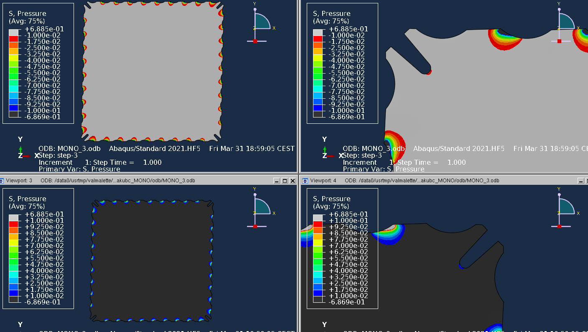

Pressure ($p=-\frac{1}{3}tr(\sigma)$). MONO_3 AVEC entaille

$\sigma_{12_{Field}}=0.0666~\mbox{MPa}$
$\sigma_{12_{Panto}}=0.0675~\mbox{MPa}(+1.4\%)$

</lab>

---

# Bilan monolithique

c'est cool.

---

# Etude du nid d'abeille

- Epaisseur : 20 mm
- Module d'Young : 150 MPa (effort approx. 150 N/cyl)
- $\nu$ : 0.3
- Porosité des motif : 73%

---

# Mapping 30.8 (11/10 de 28)

<ce>

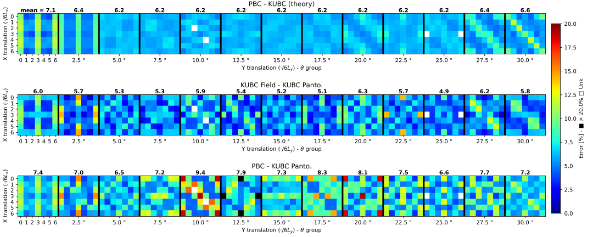

---

## Mapping 28 (10/10 de 28)

<ce>

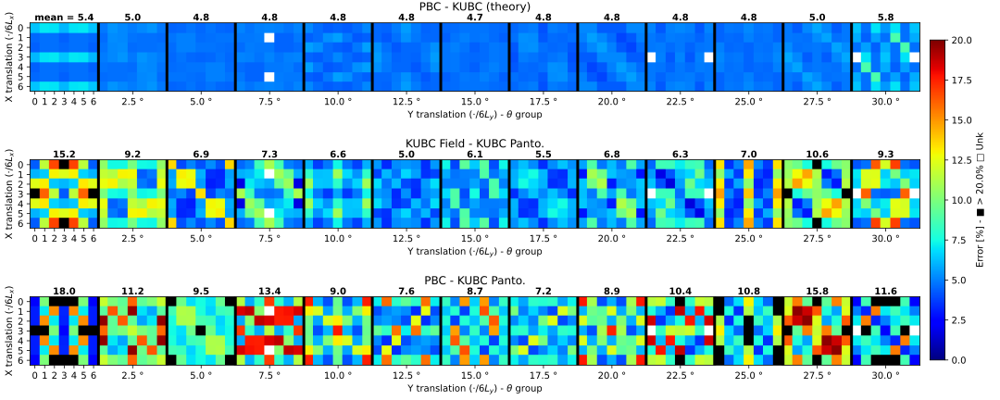

---

## Mapping 25.2 (9/10 de 28)

<ce>

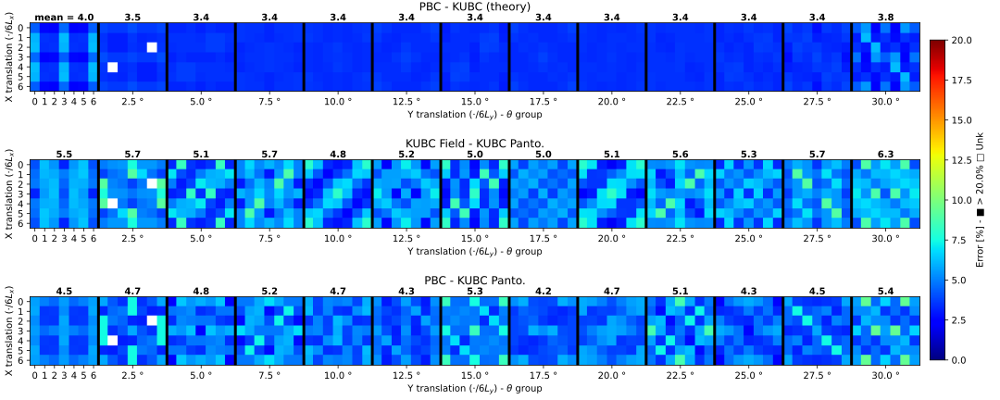

---

## Bilan des erreurs de tous les mapping
### Erreur PBC - Panto

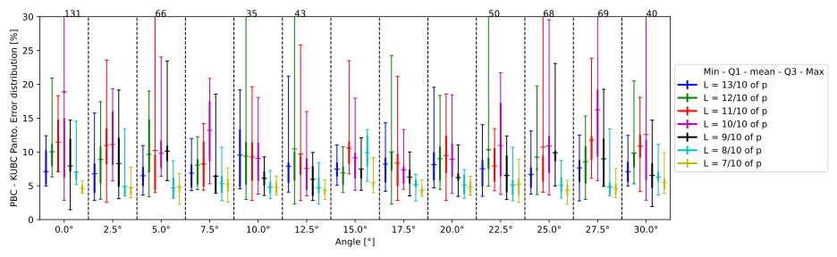

---

## Bilan des erreurs de tous les mapping
### Erreur PBC - KUBC theorique

.svg)

---

## Bilan des erreurs de tous les mapping
### Erreur KUBC theorique - KUBC field

-KUBC_Field.svg)

---

# Planing
1. Ecriture de la doc (y'a du taf là) (et nettoyage des scripts)
2. Ecriture du rapport (et présentation soutenance)
3. Ecriture de l'article

---
